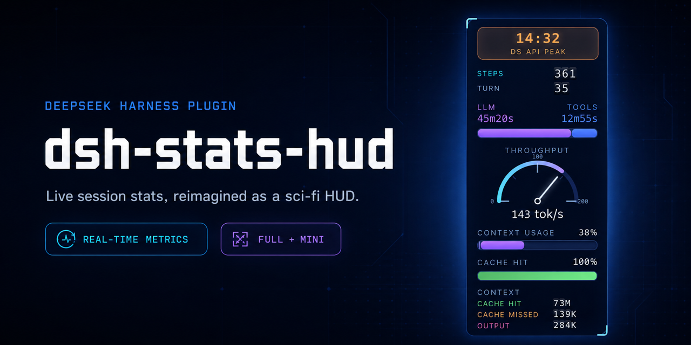
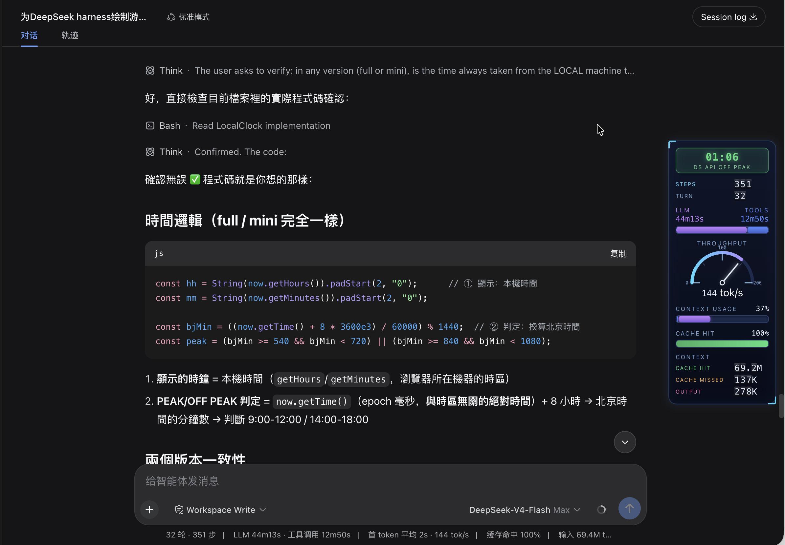
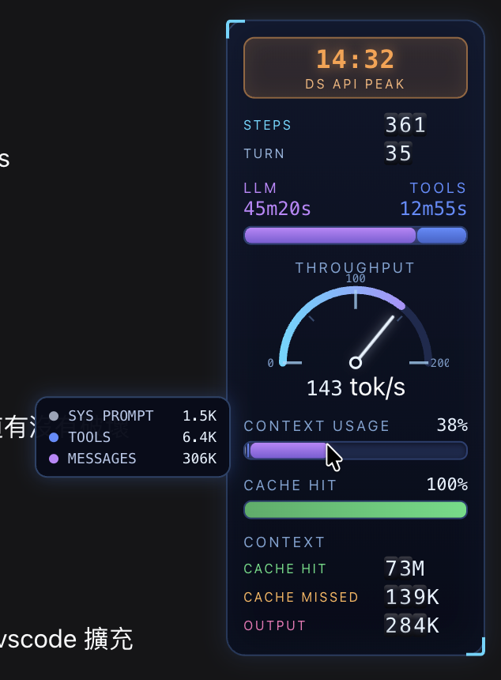
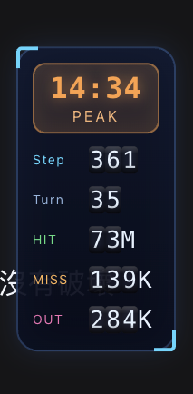
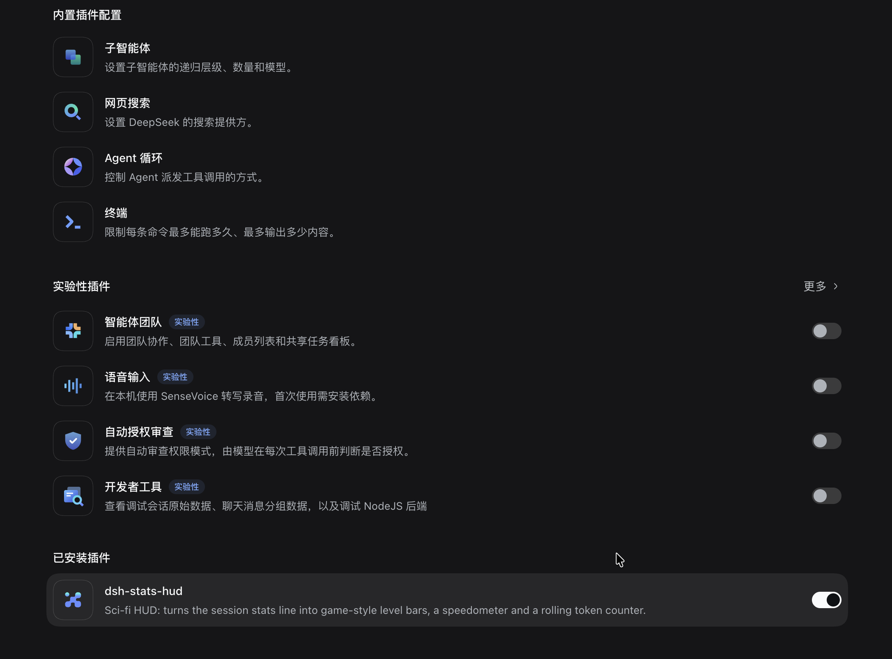

<div align="center">

[**English**](README.md) · **简体中文**

</div>

# dsh-stats-hud

为 [DeepSeek Harness](https://github.com/deepseek-ai/deepseek-harness) 打造的科幻风格 HUD：把会话的实时统计数据变成游戏风格的经验条，以**固定在 Web 界面最右侧边缘的垂直竖栏**形式呈现——完全不改动原有的统计行。

> **安装：** 在 DeepSeek Harness Desktop 应用中打开 **插件 → 添加插件**，粘贴 `https://github.com/lauytgary/dsh_hud_plugin`，点 **安装**，再点 **立即启用**。[完整步骤 ↓](#安装)



## 更新记录

**2026-11-05 — 已适配 DSH 0.2.1-rc.5（当前 Desktop 版本）**

- 重新逐项核对 HUD 依赖的所有接口（对象为正在运行的 `dsh 0.2.1-rc.5`，即 Desktop 应用内置运行时）：`conversation.composer.dock` 仍由 composer bar 宣告、仍受「先宣告、后挂载」约束，因此 `ctx.slots.inject(...)` 注册方式保持不变；dock 的 `id` / `order` / `label` 参数、`useSession` / `useProjection` 标准 props、四个投影（`sessionStats`、`tokenUsage`、`contextPressure`、`contextBreakdown`）及其字段名、`[data-composer-card]` / `data-slot` DOM 标记、`style[data-plugin]` 样式归属约定与 `window.__ModuleLoader__.load({ id, factory })` 均未变化。
- 原生统计行现在拆成**两个** dock 条目（`activity`，order 0；`usage`，order 1），不再是单个 `stats` 条目。HUD 保留自己的 id（`dsh-stats-hud`，order 1），只作为新增条目并列显示，不会替换任何一个。
- 格式化函数与 0.2.1 原生 helper 重新对齐：`tok/s` 从 10 起取整（原为 100）；缓存命中率在接近满命中时保留一位小数，不再四舍五入成 `100%`。
- 补上缺失的 `.gsh-sub` 规则，THROUGHPUT 的单位（`tok/s`）终于有自己的小号弱化样式。
- manifest：移除未使用的 `dsh.client.inject` 项（`@deepseek-ai/dsh-client-locale`、`@deepseek-ai/dsh-client-ui-conversation`——0.2.1 只把 `inject` 当作加载顺序提示，而本 bundle 只 require `react`）与 `react` peer 依赖（`require("react")` 由客户端平台的 seed 提供，保留 peer 只会让 pnpm 往 profile 里多装一份 `react@18`）；声明 `dsh.manifestVersion: 1`。包版本升到 `0.1.2`。
- 文档：安装一节改为 Desktop 优先的分步指引（**插件 → 添加插件 → 安装第三方插件 → 立即启用**），保留 CLI 方式，并加上「确认装好了」与故障排查表；两张插件列表截图换成 0.2.1 的插件页实拍。

**2026-09-11 — 已对 DSH 0.1.5-rc.1 验证（无需改动代码）**

- 重新逐项核对 HUD 依赖的所有接口（对象为 `dsh 0.1.5-rc.1`，客户端套件 `0.1.5-rc.2`）：`conversation.composer.dock` 仍由 composer bar 宣告、仍受「先宣告、后挂载」约束，因此 `ctx.slots.inject(...)` 注册方式保持不变；dock 的 `id` / `order` / `label` 参数、`useSession` / `useProjection` 标准 props（另新增 `useResource` / `usePanelInfo`）、四个投影（`sessionStats`、`tokenUsage`、`contextPressure`、`contextBreakdown`）以及 `[data-composer-card]` / `data-slot` DOM 标记均未变化。
- manifest 契约未变（`dsh.bundle.patch`、`dsh.client.platform`、`window.__ModuleLoader__.load({id, factory})`）；`dsh plugin` 仍是 pnpm 前导命令。移除了一条失效的 `dsh.client.inject` 项：`@deepseek-ai/dsh-client-runtime` 在新版整棵树中已不存在（未知名称为安全忽略）。包版本升到 `0.1.1`。
- 文档：「安装」一节现在区分两条重载路径——`link:` 仓库下修改客户端代码会由默认挂载的 `@deepseek-ai/dsh-client-hmr` **热重载**；而 `add` / `remove` / `update` 仍需重启 `dsh web`。

**2026-09-08 — 兼容 DSH 0.1.2-rc.1（插槽注册改为「先宣告、后挂载」）**

- DSH `0.1.2-rc.1` 重构了 Web 客户端的插槽体系：`slots.register()` 现在只是纯粹的「挂载」API，若目标插槽尚未由**父条目的 children table 宣告**，会直接抛错。composer 子树（包括 `conversation.composer.dock`）是由会话 UI 树**惰性宣告**的——时机在 plugin（loader 条目）apply 之后，因此原先在 `apply()` 中直接调用 `ctx.slots.register(...)` 会失败，报 `slot "conversation.composer.dock" is not declared (a parent entry's children table must declare it)`，DSH 启动时提示 **Failed to load plugins**。
- 现在改为通过 `ctx.slots.inject("conversation.composer.dock", () => ctx.slots.register({ name, id, order }, …))` 注册——与原生 StatsLine 使用同一插槽的方式完全一致。`slots.inject` 在插槽已宣告时立即执行工厂函数，否则等待其（重新）宣告后再执行；等待与注册的生命周期都挂在插件自己的 fiber 上，卸载时自动清理。
- 除此之外无需任何改动：dock 插槽的标准 props（`useSession` / `useProjection`）、`[data-composer-card]` / `data-slot` DOM 标记以及 HUD 读取的所有投影在 `0.1.2-rc.1` 中均未变化（已对照所安装的包源码逐一确认）。
- 同步更新文档（本文件与 `README.md`）。

**2026-08-24 — 更新尖峰 / 错峰时段**

- `CLOCK` 徽章现按 DeepSeek 官方峰谷定价执行：尖峰 = **周一至周五** 北京时间 09:00-12:00 / 14:00-18:00（即周一至周五 01:00-04:00 / 06:00-10:00 UTC）；**周末一律为错峰**（此前周末这两个时段会被错误显示为 PEAK）。
- 将判断重构为纯函数 `isDsApiPeak(date)`（按北京日历的星期判断，任何时区都正确），并加入 test-only 的 `__test` 导出。
- 新增 3 组单元测试，覆盖窗口边界、周末与北京/UTC 跨日边界（共 9 个测试，全部通过）。
- 同步更新文档（本文件、`README.md` 与「参数调优」一节）。

## 从旧版 DSH 升级

DSH 自 `0.1.2-rc.1` 起把插槽注册改为「先宣告、后挂载」后，在此改动之前安装的
插件会在启动时报错：

```
Failed to load plugins
dsh-stats-hud
failed to apply loader entry … (dsh-stats-hud): slot "conversation.composer.dock" is not declared (a parent entry's children table must declare it)
```

把插件更新到修复版（见上方 2026-09-08 的更新记录），然后重新加载：

- **从本地仓库安装**（`link:` 依赖）：更新仓库内容（`git pull`，或把新文件拷
  过去）。客户端部分会由 `@deepseek-ai/dsh-client-hmr` 热重载进正在运行的页
  面；仅当插件的宿主部分或其 `cordis.patch.yml` 补丁有变化时，才需要重启
  宿主（Desktop 应用或 `dsh web`）。
- **从 GitHub 或 npm 安装**：用 `dsh plugin --profile <profile> update dsh-stats-hud`
  重新解析最新版本，或先 `remove` 再重新 `add` 该包，然后**重启宿主**——
  新解析出的安装路径会在启动时组合。

快速确认是否已更新到修复版：插件客户端代码应包含新的注册写法
`ctx.slots.inject("conversation.composer.dock", …)`（见 `lib/client.js`）。

若重启后仍弹出错误，请强制刷新浏览器页面（`Cmd+Shift+R`）——插件的浏览器代
码按页面加载缓存。

## 仪表（全英文、LLM 术语）

| 仪表 | 数据 | 满量程 | 超出满量程 |
| --- | --- | --- | --- |
| `CLOCK` 徽章 | 本地时间（24 小时制）+ `DS API PEAK` / `DS API OFF PEAK` 时段标识 | 高峰时段 = 北京时间周一至周五 09:00-12:00 / 14:00-18:00（即周一至周五 01:00-04:00 / 06:00-10:00 UTC）；周末及所有其余时段均为错峰（半价） | PEAK 呈橙色、OFF PEAK 呈绿色 |
| `STEPS / TURN` 滚动行 | 步骤 / 回合数，以里程表滚筒样式滚动（类似 CONTEXT 行） | — | 挂载时滚筒旋转启动，数值变化时滚动 |
| `LLM / TOOLS` 双栏 | 两列（标签在上、数值在下），条形分段 = LLM:TOOLS 原始时间占比 | 无上限——2:1 的时间比就显示 2:1 的条 | — |
| `THROUGHPUT` 仪表盘 | tokens/s（吞吐量），标题居中，组合读数居中（`146 tok/s`） | 红线自动缩放 200→300→400…（弧形刻度随之变化） | — |
| `CONTEXT USAGE` 条 | 上下文窗口使用百分比，3 段：系统提示（灰）/ 工具（蓝）/ 消息（紫），按 token 占比 | 0-100% | ≥80% 整条变实心红；悬停显示三个 token 数 |
| `CACHE HIT` 条 | 缓存命中百分比 | 0-100% | <50% 红、<80% 黄、≥80% 绿 |
| `CONTEXT` 滚动计数器 | 三行里程表：CACHE HIT（绿）/ CACHE MISSED（橙）/ OUTPUT（粉） | 挂载时滚筒从 0 开始旋转；数字增加时向上滚动（9→0 进位），减少时向下滚动 | — |

Agent 运行期间，整个面板会「呼吸」起伏，进度条随之脉动。

悬停在 `CONTEXT USAGE` 条上会弹出 token 明细提示：



## 响应式布局

HUD 会根据聊天栏右侧的可用空间自适应（通过 ResizeObserver 实时测量，因此拖拽侧栏、打开详情抽屉、调整窗口大小都会生效）：

| 档位 | 条件 | 显示内容 |
| --- | --- | --- |
| `full` | 窗口 ≥ 800px 且可用空间 ≥ 180px | 全部内容 |
| `mini` | 窗口 ≥ 800px 且可用空间 < 180px | 时钟（短版 PEAK/OFF PEAK 徽章）+ 紧凑滚动行（Step/Turn/HIT/MISS/OUT） |
| `hidden` | 窗口 < 800px | 不显示（元素保持挂载，`display:none`） |

窗口宽度是硬性底线：低于 800px 时即使空间充足也会隐藏面板，只有测得的空间决定 `full` 还是 `mini`（完整面板需要 164px + 12px 边距）。窄窗口下 `mini` 可能与聊天栏轻微重叠——由于面板可点击穿透，这很安全。若无法测量聊天栏，面板会回退为 `full`。

`mini` 档位在窄窗口下的效果：



## 环境要求

- DeepSeek Harness `dsh` **0.2.1-rc.5**（macOS；Desktop 应用内置运行时）。插槽注册为「先宣告、后挂载」，因此插件通过 `ctx.slots.inject(...)` 模式注册——见更新记录
- pnpm（用于插件管理）

## 安装

### Desktop 应用（推荐）

1. 打开侧边栏的 **插件（Plugins）** 页，点 **添加插件（Add plugin）**。
2. 选 **安装第三方插件（Install a third-party plugin）**，粘贴下面任意一种：

   | 形式 | 示例 |
   | --- | --- |
   | Git 地址 | `https://github.com/lauytgary/dsh_hud_plugin` |
   | 本地仓库 | `/absolute/path/to/dsh-stats-hud` |
   | npm 包名 | `dsh-stats-hud`（尚未发布） |

3. 点 **安装（Install）**，等 pnpm 跑完，再点 **立即启用（Enable now）**。
4. HUD 会立刻出现在对话最右侧——无需重启，也无需刷新页面。

**插件 → 已安装** 里的卡片会显示它的来源 spec；用本地仓库（`link:`）最方便跟进更新：`git pull` 之后客户端部分会自动热重载。

### 命令行

```sh
dsh plugin --profile <profile> add https://github.com/lauytgary/dsh_hud_plugin
```

Desktop 应用用 `--profile desktop`，`dsh web` 用 `web`。该命令会写入依赖**并**选中 bundle，但运行中的宿主只在启动时组合：装完**重启宿主**（`dsh web` 重启后还需刷新页面）。本地路径会以 `link:` 依赖安装，修改 `lib/client.js` 无需重装——`@deepseek-ai/dsh-client-hmr` 会把插件重新应用进正在运行的页面。

### 确认装好了

- **插件 → 已安装** 中 `dsh-stats-hud` 的开关为开启：

  

- 会话记录过至少一步之后，HUD 竖栏出现在窗口最右侧。

## 故障排查

| 现象 | 处理 |
| --- | --- |
| 完全看不到 HUD | 会话还没有 steps/tokens，或窗口宽度小于 800px 时它本来就会隐藏 |
| 装了但没显示 | 到 **插件 → 已安装** 把开关打开 |
| 卡片显示错误 | pnpm 取不到 spec（GitHub 连不上、本地路径已移动）——打开卡片重装 |
| 用 CLI 装的 | 重启宿主：CLI 无法重组正在运行的 app |

## 卸载

在 **插件 → 已安装** 的卡片上卸载，或：

```sh
dsh plugin --profile <profile> remove dsh-stats-hud
```

## 工作原理

- 注册到 `conversation.composer.dock` 插槽（id `dsh-stats-hud`，顺序 1）——**只是为了拿到会话作用域的 hooks**（`useSession` / `useProjection`）；面板本身是 `position: fixed`，不占用布局空间，原有统计行保持不变。注册通过 `ctx.slots.inject(...)` 进行——新版 DSH 要求插槽先由其父条目声明，`inject` 会等待该声明就绪后再注册。
- 数据来自与原生界面相同的投影：`useProjection("sessionStats")`、`useProjection("tokenUsage")`、`useProjection("contextPressure")` 和 `useProjection("contextBreakdown")`——宿主端零改动。
- `exports.inject = ["slots"]` 是必需的：DSH 的 ctx 是严格代理，读取未在其中声明的服务会抛错（`service "slots" is not declared by your plugin`）。包级 `dsh.client` 声明无需 `inject` 列表——本 bundle 只 require `react`。
- 面板是 `pointer-events: none`（点击穿透）；只有 CONTEXT USAGE 条重新启用了指针事件，以便悬停提示生效。

## 文件结构

```
dsh-stats-hud/
├── package.json          # dsh.bundle（补丁层）+ dsh.client（浏览器入口）
├── cordis.patch.yml      # 将插件插入加载器条目
├── lib/
│   ├── index.js          # 宿主端无操作（纯浏览器插件）
│   └── client.js         # 浏览器打包：HUD 组件 + 插槽注册
└── test/
    └── format.test.js    # 纯函数单元测试（node:test，零依赖）
```

`lib/client.js` 是手写的加载器打包文件（`window.__ModuleLoader__.load`）——无需构建步骤。

## 开发与测试

```sh
npm test   # 纯函数单元测试（node:test，零依赖；需要 Node ≥ 18）
```

测试会用 Node VM 加载 `lib/client.js`（stub 掉 loader，无需 DOM），覆盖纯函数：
`formatTokens` / `formatDuration` / `formatTps` / `tierOf` / `billedInputTokens` / `cacheHitPercent` / `isDsApiPeak`。
test-only 的 `__test` 导出由 `DSH_HUD_TEST` 环境变量门控，浏览器端不会触发，bundle 不受影响。

## 参数调优

所有常量都在 `lib/client.js` 中：

- 标签：`L` 对象（全英文 LLM 术语）
- 高峰时段：`LocalClock` 委托给 `isDsApiPeak(date)`，按北京时间（UTC+8）星期 `bjDow >= 1 && bjDow <= 5`（周一至周五）且 `bjMin >= 540 && bjMin < 720`（9-12 点）或 `>= 840 && < 1080`（14-18 点）判断，其中 `bjMin` / `bjDow` 取自 `new Date(date.getTime() + 8*3600e3)`——周末一律为错峰
- `MissionRolling`：步骤 / 回合的滚动滚筒（无满量程）
- `ChannelBar`：分段比例 = `llmMs / (llmMs + toolMs)`（无上限）
- `SpeedGauge` 的 `redline = 200`（初始值；以 100 tok/s 为步进自动缩放）
- `ContextUsageBar`：分段颜色和 ≥80% 实心红阈值；悬停提示从 `contextBreakdown` 投影读取 `systemTokens` / `toolsTokens` / `messageTokens`
- 滚动计数器：`DRUM`（3× 0-9）、`DRUM_H = 15`（每位数像素）、`RollingValue` 的进位 / 借位公式以及挂载时的旋转启动
- CSS：`position:fixed; right:12px`；档位在 `tierOf(space, width)` 中——`width < 800` → `hidden`（窗口宽度兜底）、`space >= 180` → `full`、其余 → `mini`（测量失败时回退为 `full`）以及 `.gsh-root.gsh-*` 规则；`@media (prefers-reduced-motion: reduce)` 会停用脉冲与过渡动画

## 发布到 npm（可选）

```sh
# 先移除 package.json 中的 "private": true，然后
npm publish
# 用户安装方式：
dsh plugin --profile <profile> add dsh-stats-hud
```

## 联系

有问题、想法或建议？欢迎到 GitHub Discussions 讨论：

- [Discussions（讨论区）](https://github.com/lauytgary/dsh_hud_plugin/discussions)

## 许可证

MIT
