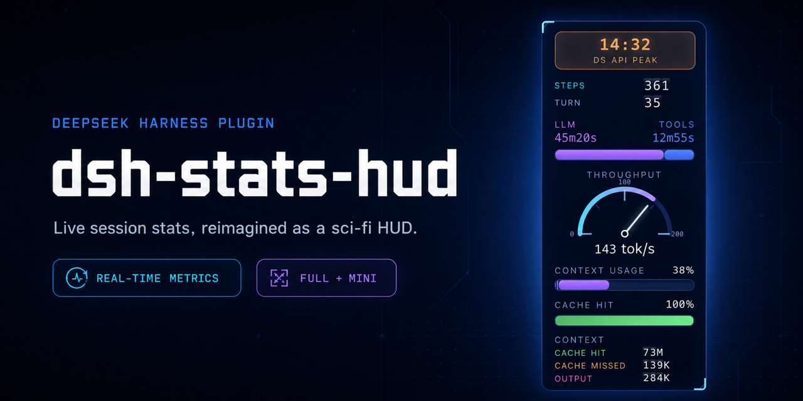
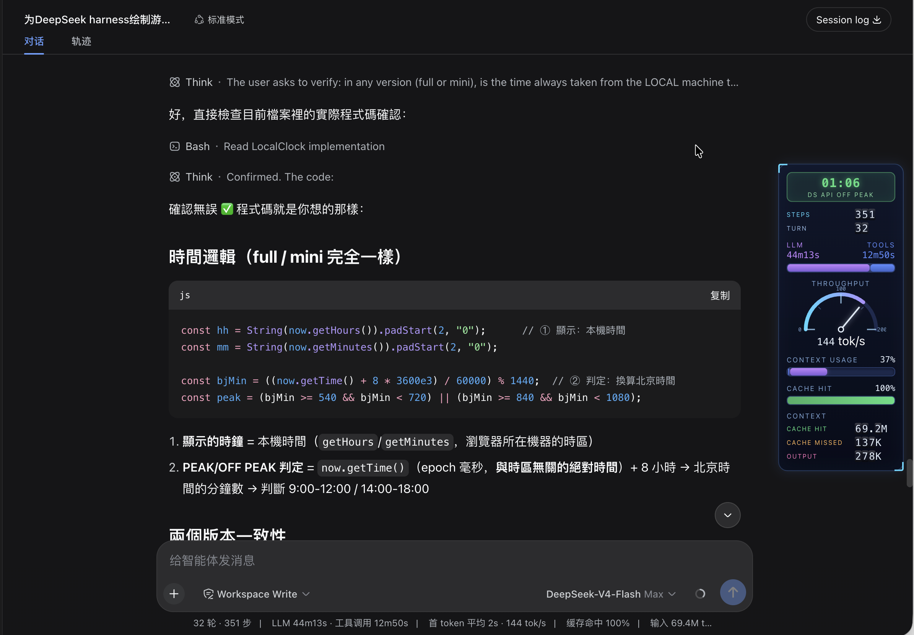
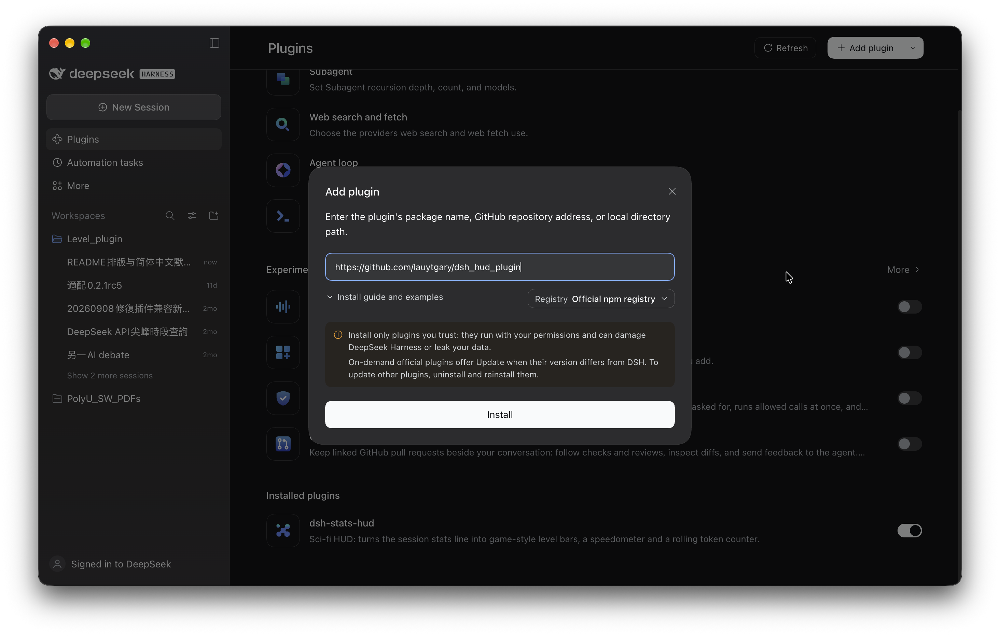
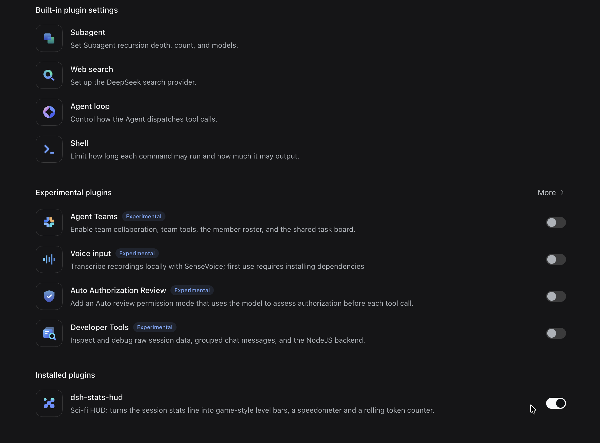
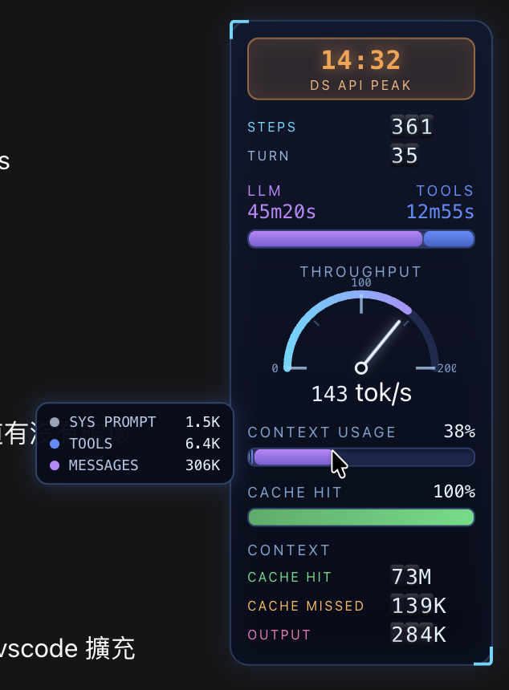
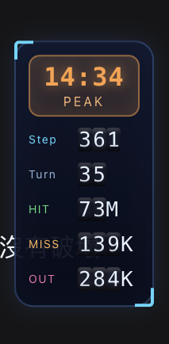

<div align="center">

**English** · [**简体中文**](README.md)

</div>

# dsh-stats-hud

A sci-fi HUD for [DeepSeek Harness](https://github.com/deepseek-ai/deepseek-harness): the session's stats become game-style level bars in a **vertical column fixed to the far right edge** of the web UI — without touching the original stats line.

> **Install:** in the DeepSeek Harness Desktop app open **More → Browse other plugins** in the sidebar, press **Add plugin**, paste `https://github.com/lauytgary/dsh_hud_plugin`, press **Install**, then **Enable now**. [Full instructions ↓](#install)



## Install

### Requirements

- DeepSeek Harness `dsh` **0.2.2-rc.3** (macOS; the Desktop app's bundled runtime). Slot registration is declaration-gated, so the plugin registers through the `ctx.slots.inject(...)` pattern, and a fixed overlay must portal to `<body>` or the composer's containing block captures it — see Changelog
- pnpm (for plugin management)

### Desktop app (recommended)

1. Open **More** in the sidebar and choose **Browse other plugins** to open the **Plugins** page.
2. Press **Add plugin** in the top-right corner.
3. Paste one of these (keep the registry on **Official npm registry** — a Git address never goes through npm):

   | Spec | Example |
   | --- | --- |
   | Git address | `https://github.com/lauytgary/dsh_hud_plugin` |
   | Local checkout | `/absolute/path/to/dsh-stats-hud` |

4. Press **Install**, let pnpm finish, then press **Enable now**.
5. The HUD appears at the far right of the conversation right away — no restart, no page refresh.



The card under **Plugins → Installed** always shows the spec it was installed from, so a local checkout (`link:`) is the easiest way to keep up: `git pull` and the client half hot-reloads.

### Command line

```sh
dsh plugin --profile <profile> add https://github.com/lauytgary/dsh_hud_plugin
```

Use `--profile desktop` for the Desktop app and `web` for a `dsh web` profile. The command installs the dependency **and** selects the bundle, but a running host only composes it at boot: **restart the host** afterwards (refresh the page after a `dsh web` restart). A local path installs as a `link:` dependency, so editing `lib/client.js` never needs a reinstall — `@deepseek-ai/dsh-client-hmr` re-applies the plugin in the running page.

### Check that it works

- **Plugins → Installed** lists `dsh-stats-hud` with its switch on:

  

- The HUD column sits at the far right edge of the window once the session has recorded a step.

## Changelog

**2026-11-17 — a split view shows only the rightmost pane's HUD; measurement is per pane**

- Fixed the two stacked HUDs: a split view (a subagent pane beside its parent) mounts one composer — and one dock — per pane, and every instance used to pin its panel to the window's right edge, so the panels landed exactly on top of each other. Only the **rightmost pane** renders the panel now (`rightmostPane()` compares the right edges of every `[data-conversation-content]`); the other instances keep just the zero-size `.gsh-anchor` probe, so when the rightmost pane closes the remaining one takes over automatically.
- Fixed the left pane counting its neighbour as free space: the tier now measures `paneSpace(paneRight, cardRight)` — the gutter between this pane's composer card and this pane's own right edge — and the panel's right inset comes from `paneInset()`, relative to its own pane. Opening a right sidebar (terminal/files/browser) therefore moves the HUD with the pane instead of leaving it floating over the panel.
- A split pane only has ~20px of gutter, so it lands on `mini` and covers roughly 60px of that pane's text — a deliberate trade-off (the panel is click-through and every pane keeps its native stats line). Single-pane behaviour is unchanged (right edge, `full`).
- New pure helpers `paneSpace` / `paneInset` (exported through `__test` and covered by the unit tests, now 12). Package `0.1.5`.

**2026-11-17 — `CONTEXT` gains a `TOTAL` row (the stock usage sum)**

- The `CONTEXT` block ends with a new `TOTAL` row: CACHE HIT + CACHE MISSED + OUTPUT, which is exactly the number the stock token-usage pill under the composer prints (`billedInputTokens(usage) + usage.outputTokens`, confirmed against the 0.2.2 `UsagePill` source). A hairline above it keeps it reading as a sum rather than a fourth bucket.
- Both tiers get the row (`mini` uses the short `TOTAL` label beside Step/Turn/HIT/MISS/OUT).
- New pure helper `totalTokens(usage)` (exported through `__test` and covered by the unit tests, now 10 in total); the instrument table, responsive table and development list are mirrored in both READMEs.

**2026-11-17 — Adapted to DSH 0.2.2-rc.3: the HUD is portalled into `<body>`**

- Fixed the post-upgrade misplacement: the column was no longer centred against the window's right edge but dropped low, covering the composer, with its bottom clipped by the window edge. DSH 0.2.2 wraps the composer in a `position: sticky` **composer seat** carrying `will-change: transform`; an ancestor with a transform (including `will-change: transform`) becomes the **containing block** of `position: fixed` descendants, so `top: 50%` / `right: 12px` resolved against the composer instead of the viewport and the panel overflowed the window bottom. DSH's own dock catalog states the same rule: a fixed overlay must portal to the document body because the docked composer contains it.
- Fix: the panel is rendered into `<body>` through `react-dom`'s `createPortal`, so `position: fixed` is viewport-relative again; only a zero-size `.gsh-anchor` stays in the dock so the responsive tier probe can still measure the free space right of `[data-composer-card]`. The tier logic itself is unchanged.
- Manifest: `dsh.client.external` declares `react` and `react-dom` (both come from the client module table, nothing extra is installed). Package version bumped to `0.1.3`.
- Also fixed the clipped speedometer end labels (`300` read as `30`): the SVG `viewBox` gains 8 user units on each side, with the width scaled to keep the dial the same on-screen size.
- Re-checked the 0.2.2-rc.3 dock contract: still `kind: list` / `scope: session`, still the two native entries `activity` (order 0) and `usage` (order 1), and `useSession` / `useProjection` plus all four projection field names are unchanged.

**2026-11-17 — Simplified Chinese README by default; Install moved up**

- `README.md` is now the Simplified Chinese README (the page GitHub renders by default); the English one moved to `README-EN.md`, and the language switcher on both sides points there. `README-CN.md` no longer exists (it was renamed, so git history follows).
- Layout: Install now comes right after the intro, with Requirements folded in as its first subsection; the Changelog sits below it. Every other section keeps its previous order.
- Historical changelog notes that pointed at `README-CN.md` now just say "both READMEs".
- Dropped the npm package row from the install table (the package is not published yet, so it should not look like a working option); add it back once it is on npm.
- Install now starts from the sidebar's **More → Browse other plugins** entry (then **Add plugin**), with fresh 0.2.1 screenshots of the filled-in dialog (`docs/plugin_install_chi.png`, `docs/plugin_install_eng.png`).

**2026-11-05 — Adapted to DSH 0.2.1-rc.5 (the current Desktop release)**

- Re-audited every interface the HUD touches against the running `dsh 0.2.1-rc.5` (the Desktop app's bundled runtime): `conversation.composer.dock` is still declared by the composer bar and still declaration-gated, so the `ctx.slots.inject(...)` registration stays as-is; the dock's `id` / `order` / `label` options, the `useSession` / `useProjection` standard props, all four projections (`sessionStats`, `tokenUsage`, `contextPressure`, `contextBreakdown`) with unchanged field names, the `[data-composer-card]` / `data-slot` DOM markers, the `style[data-plugin]` style-ownership convention and `window.__ModuleLoader__.load({ id, factory })` are unchanged.
- The stock stats line is now **two** dock entries (`activity`, order 0, and `usage`, order 1) instead of one `stats` entry. The HUD keeps its own id (`dsh-stats-hud`, order 1), so it is added beside them and never replaces one.
- Formatters re-synced with the 0.2.1 stock helpers: `tok/s` rounds to an integer from 10 up (was 100), and the cache-hit percentage keeps one decimal for a near-full hit instead of rounding up to `100%`.
- Added the missing `.gsh-sub` rule, so the THROUGHPUT unit (`tok/s`) finally has its own small muted style.
- Manifest: dropped the unused `dsh.client.inject` entries (`@deepseek-ai/dsh-client-locale`, `@deepseek-ai/dsh-client-ui-conversation` — 0.2.1 uses `inject` only as a load-order hint, and this bundle requires nothing but `react`) and the `react` peer dependency (`require("react")` resolves through the client platform seed, so the peer only made pnpm install a stray `react@18` into the profile); declared `dsh.manifestVersion: 1`. Package version bumped to `0.1.2`.
- Docs: the Install section is now a Desktop-first walkthrough (**Plugins → Add plugin → Install a third-party plugin → Enable now**) with a CLI fallback, a “Check that it works” step and a troubleshooting table; both plugin-list screenshots were replaced with 0.2.1 captures of the Plugins page.

**2026-09-11 — Verified against DSH 0.1.5-rc.1 (no code changes needed)**

- Re-audited every interface the HUD touches against `dsh 0.1.5-rc.1` (client packages `0.1.5-rc.2`): `conversation.composer.dock` is still declared by the composer bar and still renders declaration-gated, so the `ctx.slots.inject(...)` registration stays as-is; the dock's `id`/`order`/`label` options, the `useSession` / `useProjection` standard props (plus two new ones, `useResource` / `usePanelInfo`), all four projections (`sessionStats`, `tokenUsage`, `contextPressure`, `contextBreakdown`) and the `[data-composer-card]` / `data-slot` DOM markers are unchanged.
- Manifest contract unchanged (`dsh.bundle.patch`, `dsh.client.platform`, `window.__ModuleLoader__.load({id, factory})`); `dsh plugin` is still a pnpm forwarder. Removed a dead `dsh.client.inject` entry: `@deepseek-ai/dsh-client-runtime` no longer exists in the tree (unknown names are ignored harmlessly). Package version bumped to `0.1.1`.
- Docs: the Install section now distinguishes the two reload paths — client-half edits in a `link:` checkout are **hot-reloaded** by the default `@deepseek-ai/dsh-client-hmr`, while `add` / `remove` / `update` still need a `dsh web` restart.

**2026-09-08 — DSH 0.1.2-rc.1 compatibility (slot registration became declaration-gated)**

- DSH `0.1.2-rc.1` reworked the web client's slot system: `slots.register()` is now a pure *attachment* API and throws unless the target slot has already been **declared by a parent entry's children table**. The composer subtree — including `conversation.composer.dock` — is declared lazily by the conversation UI tree, i.e. *after* plugin loader entries have applied, so the old direct `ctx.slots.register(...)` call in `apply()` failed with `slot "conversation.composer.dock" is not declared (a parent entry's children table must declare it)` and DSH showed **Failed to load plugins** at startup.
- Registration now goes through `ctx.slots.inject("conversation.composer.dock", () => ctx.slots.register({ name, id, order }, …))` — the same pattern the stock StatsLine uses for the very same slot. `slots.inject` runs the factory immediately when the slot is already declared, otherwise waits for its (re)declaration, and the whole wait + registration rides the plugin's own fiber for cleanup.
- Nothing else needed to change: the dock slot's standard props (`useSession` / `useProjection`), the `[data-composer-card]` / `data-slot` DOM markers and every projection the HUD reads are unchanged in `0.1.2-rc.1` (verified against the installed package sources).
- Docs synced (both READMEs).

**2026-08-24 — Peak / off-peak windows updated**

- `CLOCK` badge now follows the official DeepSeek API peak-valley pricing: peak = **Mon–Fri** Beijing 09:00-12:00 / 14:00-18:00 (i.e. Mon–Fri 01:00-04:00 / 06:00-10:00 UTC); **weekends are always OFF-PEAK** (previously weekends inside those windows were wrongly shown as PEAK).
- Refactored the check into the pure `isDsApiPeak(date)` helper (weekday resolved on the Beijing calendar, so it is correct in any timezone) and exposed it via the test-only `__test` export.
- Added 3 unit-test groups covering window edges, weekends and the Beijing/UTC day boundary (9 tests total, all green).
- Docs synced (both READMEs and the `Tuning` section).

## Upgrading from an older DSH

After DSH moved to declaration-gated slots (`0.1.2-rc.1`), an install of this
plugin made *before* that change fails at startup with:

```
Failed to load plugins
dsh-stats-hud
failed to apply loader entry … (dsh-stats-hud): slot "conversation.composer.dock" is not declared (a parent entry's children table must declare it)
```

Update the plugin to the fixed version (the 2026-09-08 Changelog entry above), then reload it:

- **Installed from a local checkout** (`link:` dependency): update the
  checkout (`git pull`, or copy the new files over). The client half is
  hot-reloaded by `@deepseek-ai/dsh-client-hmr` into the running page; restart
  the host (the Desktop app or `dsh web`) only if the plugin's host half or its
  `cordis.patch.yml` patch changed.
- **Installed from GitHub or npm**: re-resolve the latest version with
  `dsh plugin --profile <profile> update dsh-stats-hud`, or `remove` and `add` the
  package again, then **restart the host** — a newly resolved install path is
  composed at boot.

Quick sanity check that the fixed version is in place: the client code must
contain the new registration pattern `ctx.slots.inject("conversation.composer.dock", …)` (see `lib/client.js`).

If the alert still shows after the restart, hard-refresh the browser page
(`Cmd+Shift+R`) — the plugin's browser bundle is cached per page load.

### The HUD drops low after upgrading to DSH `0.2.2-rc.3`

`0.2.2-rc.3` wraps the composer in a composer seat carrying
`will-change: transform`, and an old `position: fixed` panel takes it as its
containing block: the column stops being centred against the right edge and
instead sits low, covering the composer, with its bottom clipped by the window.
Update the plugin to `0.1.3` or later (the panel now portals to `<body>`); the client
half hot-reloads, so just hard-refresh the page (`Cmd+Shift+R`) if nothing
moves.

## Instruments (all-English, LLM terminology)

| Instrument | Data | Full scale | Past full scale |
| --- | --- | --- | --- |
| `CLOCK` badge | Local time (24h) + `DS API PEAK` / `DS API OFF PEAK` rate | Peak = Mon–Fri Beijing 09:00-12:00 / 14:00-18:00 (i.e. Mon–Fri 01:00-04:00 / 06:00-10:00 UTC); weekends and all other hours are OFF-PEAK (half price) | PEAK orange tint, OFF-PEAK green tint |
| `STEPS / TURN` rolling rows | Steps / turns as odometer drums (like the CONTEXT rows) | — | Drums spin up on mount, roll on change |
| `LLM / TOOLS` dual bar | Two columns (labels over values), bar segments = raw LLM:TOOLS time ratio | No cap — 2:1 time means 2:1 bar | — |
| `THROUGHPUT` gauge | tokens/s (throughput), centered title, combined centered readout (`146 tok/s`) | Redline auto-scales 200→300→400… (arc ticks follow) | — |
| `CONTEXT USAGE` bar | Context-window usage % with 3 segments: Sys Prompt (gray) / Tools (blue) / Messages (purple) by token ratio | 0-100% | ≥80% whole bar turns solid red; hover shows the three token counts |
| `CACHE HIT` bar | Cache-hit % | 0-100% | <50% red, <80% yellow, ≥80% green |
| `CONTEXT` rolling counter | Four odometer rows: CACHE HIT (green) / CACHE MISSED (orange) / OUTPUT (pink), plus a **TOTAL** below a hairline (cyan, = CACHE HIT + CACHE MISSED + OUTPUT — the same sum the stock usage pill shows under the composer) | Drums spin up from 0 on mount; digits roll up on increase (carry 9→0), down on decrease | — |

While the agent is running the whole panel breathes and bars pulse.

Hovering the `CONTEXT USAGE` bar pops up a tooltip with the token breakdown:



## Responsive layout

The HUD measures **its own conversation pane**, not the window: free space = the gutter between this pane's composer card and this pane's right edge (measured live with a ResizeObserver, so sidebar drags, a right sidebar and window resizes all count).

- **Only the rightmost pane draws the HUD.** A split view (a subagent pane beside its parent) mounts one composer — and therefore one dock and one HUD — per pane; two `position: fixed` panels would land exactly on top of each other. The left panes render nothing, so you see the rightmost pane's numbers (the subagent's, in that layout).
- The panel's inset is relative to **its own pane's** right edge too, so opening a right sidebar (terminal/files/browser) moves the HUD with the pane instead of leaving it floating over the panel.

| Tier | Condition | Shows |
| --- | --- | --- |
| `full` | Window ≥ 800px and free space ≥ 180px | Everything |
| `mini` | Window ≥ 800px and free space < 180px | Clock (short PEAK/OFF PEAK badge) + compact rolling rows (Step/Turn/HIT/MISS/OUT/TOTAL) |
| `hidden` | Window < 800px | Nothing (element stays mounted, `display:none`) |

The window width is a hard floor: below 800px the panel hides even with room to spare, and only the measured space decides `full` vs `mini` (the full panel needs 164px + 12px margin). In a split view each pane only has ~20px of gutter, so `mini` covers roughly 60px of that pane's text — deliberate: the panel is click-through and every pane keeps its native stats line. If the pane or card markers can't be found, the panel falls back to `full` at the plain 12px inset.

The `mini` tier in a narrow window:



## Troubleshooting

| Symptom | Fix |
| --- | --- |
| No HUD at all | It hides while the session has no steps/tokens, and whenever the window is narrower than 800px |
| Installed but nothing shows | Turn its switch on under **Plugins → Installed** |
| The card shows an error | pnpm could not fetch the spec (GitHub unreachable, local path moved) — open the card and reinstall |
| Installed from the CLI | Restart the host: the CLI cannot recompose a running app |

## Uninstall

Open the card under **Plugins → Installed** and uninstall it there, or:

```sh
dsh plugin --profile <profile> remove dsh-stats-hud
```

## How it works

- Registers into the `conversation.composer.dock` slot (id `dsh-stats-hud`, order 1) — **only to receive the session-scoped hooks** (`useSession`/`useProjection`). The panel itself is `position: fixed` and is rendered into `<body>` by `react-dom`'s `createPortal`, because DSH `0.2.2` wraps the composer in a composer seat carrying `will-change: transform` and would otherwise become the panel's containing block. A zero-size `.gsh-anchor` stays in the slot so the probe can measure the gutter of **this pane** (`[data-conversation-content]`) and derive the right inset; the panel takes no layout space and the stock stats line stays untouched. In a split view only the rightmost pane renders the panel (see Responsive layout). Registration goes through `ctx.slots.inject(...)`, which waits for the slot to be declared by its parent entry (required since DSH made slot registration declaration-gated).
- Data comes from the same projections the stock UI uses: `useProjection("sessionStats")`, `useProjection("tokenUsage")`, `useProjection("contextPressure")` and `useProjection("contextBreakdown")` — zero host-side changes.
- `exports.inject = ["slots"]` is mandatory: DSH's ctx is a strict proxy, and reading any service not listed there throws (`service "slots" is not declared by your plugin`). The package-level `dsh.client` declaration needs no `inject` list — the bundle requires `react` and `react-dom` only (both come from the web front end's module table; declared in `dsh.client.external`).
- The panel is `pointer-events: none` (click-through); only the CONTEXT USAGE bar re-enables pointer events so its hover tooltip works.

## Files

```
dsh-stats-hud/
├── package.json          # dsh.bundle (patch layer) + dsh.client (browser entry)
├── cordis.patch.yml      # inserts the plugin into loader entries
├── lib/
│   ├── index.js          # host-side no-op (pure browser plugin)
│   └── client.js         # browser bundle: HUD components + slot registration
└── test/
    └── format.test.js    # pure-function unit tests (node:test, zero deps)
```

`lib/client.js` is a hand-written loader bundle (`window.__ModuleLoader__.load`) — no build step needed.

## Development & testing

```sh
npm test   # pure-function unit tests (node:test, no dependencies; Node ≥ 18)
```

The tests load `lib/client.js` in a Node VM with a stubbed loader (no DOM
needed) and exercise the pure helpers — `formatTokens`, `formatDuration`,
`formatTps`, `tierOf`, `paneSpace`, `paneInset`, `billedInputTokens`, `totalTokens`, `cacheHitPercent`, `isDsApiPeak`. The test-only
`__test` export is gated behind the `DSH_HUD_TEST` env var, so the browser
bundle is unaffected.

## Tuning

All constants live in `lib/client.js`:

- Labels: the `L` object (all-English LLM terminology)
- Peak hours: `LocalClock` delegates to `isDsApiPeak(date)`, which checks the Beijing (UTC+8) weekday `bjDow >= 1 && bjDow <= 5` (Mon-Fri) together with `bjMin >= 540 && bjMin < 720` (9-12h) / `>= 840 && < 1080` (14-18h), where `bjMin`/`bjDow` come from `new Date(date.getTime() + 8*3600e3)` — weekends are always off-peak
- `MissionRolling`: rolling drums for steps/turns (no full scale)
- `ChannelBar`: segment ratio = `llmMs / (llmMs + toolMs)` (no cap)
- `SpeedGauge`'s `redline = 200` (initial; auto-scales in 100 tok/s steps)
- `ContextUsageBar`: segment colors and the ≥80% solid-red threshold; the hover tooltip reads `systemTokens` / `toolsTokens` / `messageTokens` from the `contextBreakdown` projection
- Rolling counter: `DRUM` (3× 0-9), `DRUM_H = 15` (px per digit), `RollingValue`'s carry/borrow formula and mount spin-up
- CSS: `position:fixed` (the right inset is written as an inline style from `paneInset()`; the `right:12px` in the CSS is only the fallback when nothing could be measured); tiers in `tierOf(space, width)` — `width < 800` → `hidden` (window-width floor), `space >= 180` → `full`, else `mini` (measurement failure falls back to `full`), where `space` comes from `paneSpace(paneRight, cardRight)`; `rightmostPane()` decides which pane may draw the panel; plus the `.gsh-root.gsh-*` rules and `@media (prefers-reduced-motion: reduce)` (pulses and transitions off)

## Publishing to npm (optional)

```sh
# remove "private": true from package.json, then
npm publish
# users install with:
dsh plugin --profile <profile> add dsh-stats-hud
```

## Contact

Questions, ideas or issues? Open a discussion on GitHub:

- [Discussions](https://github.com/lauytgary/dsh_hud_plugin/discussions)

## License

MIT
