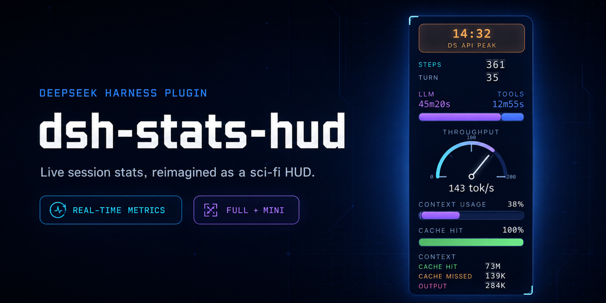
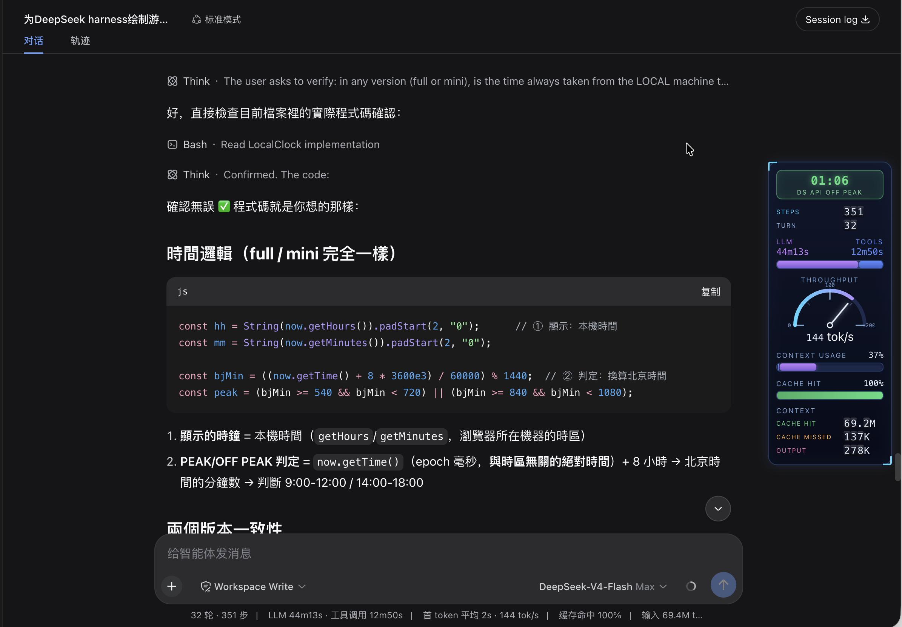
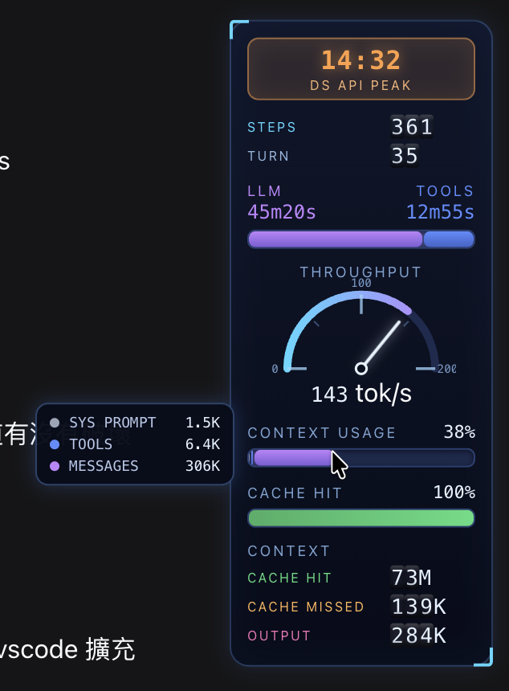
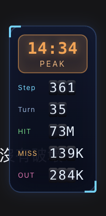
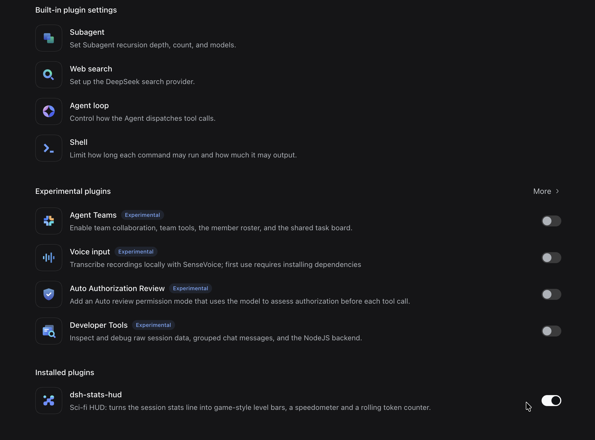

<div align="center">

**English** · [**简体中文**](README-CN.md)

</div>

# dsh-stats-hud

A sci-fi HUD for [DeepSeek Harness](https://github.com/deepseek-ai/deepseek-harness): the session's stats become game-style level bars in a **vertical column fixed to the far right edge** of the web UI — without touching the original stats line.



## Changelog

**2026-11-05 — Adapted to DSH 0.2.1-rc.5 (the current Desktop release)**

- Re-audited every interface the HUD touches against the running `dsh 0.2.1-rc.5` (the Desktop app's bundled runtime): `conversation.composer.dock` is still declared by the composer bar and still declaration-gated, so the `ctx.slots.inject(...)` registration stays as-is; the dock's `id` / `order` / `label` options, the `useSession` / `useProjection` standard props, all four projections (`sessionStats`, `tokenUsage`, `contextPressure`, `contextBreakdown`) with unchanged field names, the `[data-composer-card]` / `data-slot` DOM markers, the `style[data-plugin]` style-ownership convention and `window.__ModuleLoader__.load({ id, factory })` are unchanged.
- The stock stats line is now **two** dock entries (`activity`, order 0, and `usage`, order 1) instead of one `stats` entry. The HUD keeps its own id (`dsh-stats-hud`, order 1), so it is added beside them and never replaces one.
- Formatters re-synced with the 0.2.1 stock helpers: `tok/s` rounds to an integer from 10 up (was 100), and the cache-hit percentage keeps one decimal for a near-full hit instead of rounding up to `100%`.
- Added the missing `.gsh-sub` rule, so the THROUGHPUT unit (`tok/s`) finally has its own small muted style.
- Manifest: dropped the unused `dsh.client.inject` entries (`@deepseek-ai/dsh-client-locale`, `@deepseek-ai/dsh-client-ui-conversation` — 0.2.1 uses `inject` only as a load-order hint, and this bundle requires nothing but `react`) and the `react` peer dependency (`require("react")` resolves through the client platform seed, so the peer only made pnpm install a stray `react@18` into the profile); declared `dsh.manifestVersion: 1`. Package version bumped to `0.1.2`.
- Docs: the Install section now records that installing from **Settings → Plugins** applies to the running app without a restart, and the upgrader notes say “restart the host” instead of only `dsh web`.

**2026-09-11 — Verified against DSH 0.1.5-rc.1 (no code changes needed)**

- Re-audited every interface the HUD touches against `dsh 0.1.5-rc.1` (client packages `0.1.5-rc.2`): `conversation.composer.dock` is still declared by the composer bar and still renders declaration-gated, so the `ctx.slots.inject(...)` registration stays as-is; the dock's `id`/`order`/`label` options, the `useSession` / `useProjection` standard props (plus two new ones, `useResource` / `usePanelInfo`), all four projections (`sessionStats`, `tokenUsage`, `contextPressure`, `contextBreakdown`) and the `[data-composer-card]` / `data-slot` DOM markers are unchanged.
- Manifest contract unchanged (`dsh.bundle.patch`, `dsh.client.platform`, `window.__ModuleLoader__.load({id, factory})`); `dsh plugin` is still a pnpm forwarder. Removed a dead `dsh.client.inject` entry: `@deepseek-ai/dsh-client-runtime` no longer exists in the tree (unknown names are ignored harmlessly). Package version bumped to `0.1.1`.
- Docs: the Install section now distinguishes the two reload paths — client-half edits in a `link:` checkout are **hot-reloaded** by the default `@deepseek-ai/dsh-client-hmr`, while `add` / `remove` / `update` still need a `dsh web` restart.

**2026-09-08 — DSH 0.1.2-rc.1 compatibility (slot registration became declaration-gated)**

- DSH `0.1.2-rc.1` reworked the web client's slot system: `slots.register()` is now a pure *attachment* API and throws unless the target slot has already been **declared by a parent entry's children table**. The composer subtree — including `conversation.composer.dock` — is declared lazily by the conversation UI tree, i.e. *after* plugin loader entries have applied, so the old direct `ctx.slots.register(...)` call in `apply()` failed with `slot "conversation.composer.dock" is not declared (a parent entry's children table must declare it)` and DSH showed **Failed to load plugins** at startup.
- Registration now goes through `ctx.slots.inject("conversation.composer.dock", () => ctx.slots.register({ name, id, order }, …))` — the same pattern the stock StatsLine uses for the very same slot. `slots.inject` runs the factory immediately when the slot is already declared, otherwise waits for its (re)declaration, and the whole wait + registration rides the plugin's own fiber for cleanup.
- Nothing else needed to change: the dock slot's standard props (`useSession` / `useProjection`), the `[data-composer-card]` / `data-slot` DOM markers and every projection the HUD reads are unchanged in `0.1.2-rc.1` (verified against the installed package sources).
- Docs synced (this README and `README-CN.md`).

**2026-08-24 — Peak / off-peak windows updated**

- `CLOCK` badge now follows the official DeepSeek API peak-valley pricing: peak = **Mon–Fri** Beijing 09:00-12:00 / 14:00-18:00 (i.e. Mon–Fri 01:00-04:00 / 06:00-10:00 UTC); **weekends are always OFF-PEAK** (previously weekends inside those windows were wrongly shown as PEAK).
- Refactored the check into the pure `isDsApiPeak(date)` helper (weekday resolved on the Beijing calendar, so it is correct in any timezone) and exposed it via the test-only `__test` export.
- Added 3 unit-test groups covering window edges, weekends and the Beijing/UTC day boundary (9 tests total, all green).
- Docs synced (this README, `README-CN.md` and the `Tuning` section).

## Upgrading from an older DSH

After DSH moved to declaration-gated slots (`0.1.2-rc.1`), an install of this
plugin made *before* that change fails at startup with:

```
Failed to load plugins
dsh-stats-hud
failed to apply loader entry … (dsh-stats-hud): slot "conversation.composer.dock" is not declared (a parent entry's children table must declare it)
```

Update the plugin to the fixed version (the 2026-09-08 Changelog entry above), then reload it:

- **Installed from a local checkout** (`link:` dependency): update the
  checkout (`git pull`, or copy the new files over). The client half is
  hot-reloaded by `@deepseek-ai/dsh-client-hmr` into the running page; restart
  the host (the Desktop app or `dsh web`) only if the plugin's host half or its
  `cordis.patch.yml` patch changed.
- **Installed from GitHub or npm**: re-resolve the latest version with
  `dsh plugin --profile <profile> update dsh-stats-hud`, or `remove` and `add` the
  package again, then **restart the host** — a newly resolved install path is
  composed at boot.

Quick sanity check that the fixed version is in place: the client code must
contain the new registration pattern `ctx.slots.inject("conversation.composer.dock", …)` (see `lib/client.js`).

If the alert still shows after the restart, hard-refresh the browser page
(`Cmd+Shift+R`) — the plugin's browser bundle is cached per page load.

## Instruments (all-English, LLM terminology)

| Instrument | Data | Full scale | Past full scale |
| --- | --- | --- | --- |
| `CLOCK` badge | Local time (24h) + `DS API PEAK` / `DS API OFF PEAK` rate | Peak = Mon–Fri Beijing 09:00-12:00 / 14:00-18:00 (i.e. Mon–Fri 01:00-04:00 / 06:00-10:00 UTC); weekends and all other hours are OFF-PEAK (half price) | PEAK orange tint, OFF-PEAK green tint |
| `STEPS / TURN` rolling rows | Steps / turns as odometer drums (like the CONTEXT rows) | — | Drums spin up on mount, roll on change |
| `LLM / TOOLS` dual bar | Two columns (labels over values), bar segments = raw LLM:TOOLS time ratio | No cap — 2:1 time means 2:1 bar | — |
| `THROUGHPUT` gauge | tokens/s (throughput), centered title, combined centered readout (`146 tok/s`) | Redline auto-scales 200→300→400… (arc ticks follow) | — |
| `CONTEXT USAGE` bar | Context-window usage % with 3 segments: Sys Prompt (gray) / Tools (blue) / Messages (purple) by token ratio | 0-100% | ≥80% whole bar turns solid red; hover shows the three token counts |
| `CACHE HIT` bar | Cache-hit % | 0-100% | <50% red, <80% yellow, ≥80% green |
| `CONTEXT` rolling counter | Three odometer rows: CACHE HIT (green) / CACHE MISSED (orange) / OUTPUT (pink) | Drums spin up from 0 on mount; digits roll up on increase (carry 9→0), down on decrease | — |

While the agent is running the whole panel breathes and bars pulse.

Hovering the `CONTEXT USAGE` bar pops up a tooltip with the token breakdown:



## Responsive layout

The HUD adapts to the free space right of the chat column (measured live with a ResizeObserver, so sidebar drags, the details drawer and window resizes all count):

| Tier | Condition | Shows |
| --- | --- | --- |
| `full` | Window ≥ 800px and free space ≥ 180px | Everything |
| `mini` | Window ≥ 800px and free space < 180px | Clock (short PEAK/OFF PEAK badge) + compact rolling rows (Step/Turn/HIT/MISS/OUT) |
| `hidden` | Window < 800px | Nothing (element stays mounted, `display:none`) |

The window width is a hard floor: below 800px the panel hides even with room to spare, and only the measured space decides `full` vs `mini` (the full panel needs 164px + 12px margin). `mini` may slightly overlap the chat on narrow windows — safe because the panel is click-through. If the chat column can't be measured, the panel falls back to `full`.

The `mini` tier in a narrow window:



## Requirements

- DeepSeek Harness `dsh` **0.2.1-rc.5** (macOS; the Desktop app's bundled runtime). Slot registration is declaration-gated, so the plugin registers through the `ctx.slots.inject(...)` pattern — see Changelog
- pnpm (for plugin management)

## Install

```sh
# from a local checkout (`--profile desktop` for the Desktop app, `web` for `dsh web`)
dsh plugin --profile <profile> add /path/to/dsh-stats-hud

# or straight from GitHub
dsh plugin --profile <profile> add https://github.com/lauytgary/dsh_hud_plugin
```

Then **restart the host** — the Desktop app, or `dsh web` — so the loader composes the new entries at boot (plus a page refresh after a `dsh web` restart). Installing from **Settings → Plugins** goes through the same plugin manager against the running app and applies the change **without a restart**. The package is installed as a `link:` dependency, so local edits never need a reinstall; `@deepseek-ai/dsh-client-hmr`, which both profiles mount by default, stat-polls the package's client entry file and re-applies the plugin, so **after editing `lib/client.js` the HUD hot-reloads into the running page** (no restart, no manual refresh). A restart is only needed after the CLI adds, removes or updates a plugin — i.e. when the loader entries themselves change.

The plugin then shows up in **Settings → Plugins**:



## Uninstall

```sh
dsh plugin --profile <profile> remove dsh-stats-hud
```

## How it works

- Registers into the `conversation.composer.dock` slot (id `dsh-stats-hud`, order 1) — **only to receive the session-scoped hooks** (`useSession`/`useProjection`); the panel itself is `position: fixed`, takes no layout space, and the stock stats line stays untouched. Registration goes through `ctx.slots.inject(...)`, which waits for the slot to be declared by its parent entry (required since DSH made slot registration declaration-gated).
- Data comes from the same projections the stock UI uses: `useProjection("sessionStats")`, `useProjection("tokenUsage")`, `useProjection("contextPressure")` and `useProjection("contextBreakdown")` — zero host-side changes.
- `exports.inject = ["slots"]` is mandatory: DSH's ctx is a strict proxy, and reading any service not listed there throws (`service "slots" is not declared by your plugin`). The package-level `dsh.client` declaration needs no `inject` list — the bundle requires nothing but `react`.
- The panel is `pointer-events: none` (click-through); only the CONTEXT USAGE bar re-enables pointer events so its hover tooltip works.

## Files

```
dsh-stats-hud/
├── package.json          # dsh.bundle (patch layer) + dsh.client (browser entry)
├── cordis.patch.yml      # inserts the plugin into loader entries
├── lib/
│   ├── index.js          # host-side no-op (pure browser plugin)
│   └── client.js         # browser bundle: HUD components + slot registration
└── test/
    └── format.test.js    # pure-function unit tests (node:test, zero deps)
```

`lib/client.js` is a hand-written loader bundle (`window.__ModuleLoader__.load`) — no build step needed.

## Development & testing

```sh
npm test   # pure-function unit tests (node:test, no dependencies; Node ≥ 18)
```

The tests load `lib/client.js` in a Node VM with a stubbed loader (no DOM
needed) and exercise the pure helpers — `formatTokens`, `formatDuration`,
`formatTps`, `tierOf`, `billedInputTokens`, `cacheHitPercent`, `isDsApiPeak`. The test-only
`__test` export is gated behind the `DSH_HUD_TEST` env var, so the browser
bundle is unaffected.

## Tuning

All constants live in `lib/client.js`:

- Labels: the `L` object (all-English LLM terminology)
- Peak hours: `LocalClock` delegates to `isDsApiPeak(date)`, which checks the Beijing (UTC+8) weekday `bjDow >= 1 && bjDow <= 5` (Mon-Fri) together with `bjMin >= 540 && bjMin < 720` (9-12h) / `>= 840 && < 1080` (14-18h), where `bjMin`/`bjDow` come from `new Date(date.getTime() + 8*3600e3)` — weekends are always off-peak
- `MissionRolling`: rolling drums for steps/turns (no full scale)
- `ChannelBar`: segment ratio = `llmMs / (llmMs + toolMs)` (no cap)
- `SpeedGauge`'s `redline = 200` (initial; auto-scales in 100 tok/s steps)
- `ContextUsageBar`: segment colors and the ≥80% solid-red threshold; the hover tooltip reads `systemTokens` / `toolsTokens` / `messageTokens` from the `contextBreakdown` projection
- Rolling counter: `DRUM` (3× 0-9), `DRUM_H = 15` (px per digit), `RollingValue`'s carry/borrow formula and mount spin-up
- CSS: `position:fixed; right:12px`; tiers in `tierOf(space, width)` — `width < 800` → `hidden` (window-width floor), `space >= 180` → `full`, else `mini` (measurement failure falls back to `full`) — plus the `.gsh-root.gsh-*` rules; `@media (prefers-reduced-motion: reduce)` disables pulses and transitions

## Publishing to npm (optional)

```sh
# remove "private": true from package.json, then
npm publish
# users install with:
dsh plugin --profile <profile> add dsh-stats-hud
```

## Contact

Questions, ideas or issues? Open a discussion on GitHub:

- [Discussions](https://github.com/lauytgary/dsh_hud_plugin/discussions)

## License

MIT
